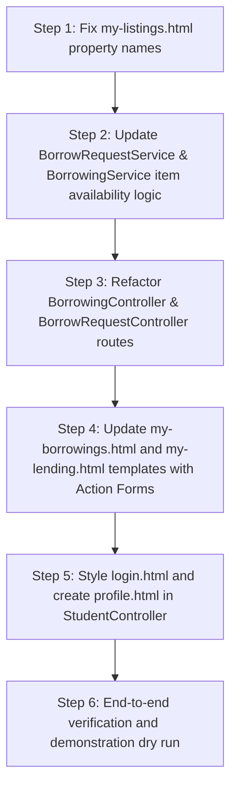

# LendLoop: Backend & Frontend Architecture Audit and Completion Roadmap

**Project Name:** LendLoop — Campus Resource Sharing Platform  
**Target Environment:** Java 21 / Spring Boot / Spring Data JPA / MySQL / Thymeleaf  
**Audit Date:** November 2026  
**Auditor:** Senior Java Full-Stack Developer & Backend Lead  

---

## 1. Executive Summary

A comprehensive architectural and code-level audit was conducted on the existing **LendLoop** college project. 

The application has a strong foundational design following clean Model-View-Controller (MVC) architecture, standard Spring Service-Repository layers, and relational domain modeling. However, **several critical defects, runtime crashes, and architectural disconnections currently prevent the complete borrowing and return lifecycle from executing properly**. 

Additionally, one critical Thymeleaf template crashes at runtime due to mismatched property names, the login page is an unstyled form fragment, and the return workflows implemented in the backend are completely disconnected from the user interface.

With targeted corrections to the entity mappings, controller routes, and Thymeleaf templates, LendLoop will be 100% operational, robust, and presentation-ready for college evaluation.

---

## 2. Technology Stack Audit

| Component | Current Specification | Evaluation & Recommendation |
|---|---|---|
| **Programming Language** | Java 21 (`<java.version>21</java.version>`) | Modern Long-Term Support (LTS) release. Retain as is. |
| **Framework** | Spring Boot 4.1.2 | Milestone/Next-Gen Spring Boot starter parent. Configured with standard starters. Retain. |
| **Persistence / ORM** | Spring Data JPA / Hibernate 6+ / Jakarta Persistence | Standard enterprise Java ORM. Configured with `hibernate.ddl-auto=update`. Retain. |
| **Database** | MySQL 8.x (`jdbc:mysql://localhost:3306/lendloop`) | Relational database with InnoDB engine and foreign keys. Retain. |
| **Security** | Spring Security 6+ / BCrypt | Password encryption active via `BCryptPasswordEncoder`. Requests set to `permitAll()` with custom session-based auth. Retain. |
| **Template Engine** | Thymeleaf 3 (`spring-boot-starter-thymeleaf`) | Server-side rendering without complex node/npm build chains. Ideal for college demo. Retain. |
| **Frontend Styling** | Plain HTML5 & Custom Embedded CSS | Lightweight, zero external build dependencies, responsive. Retain and complete missing styles. |

> **Recommendation on Stack:** **Do not replace or alter the existing technology stack.** The server-side Thymeleaf + Spring Boot + MySQL architecture eliminates CORS issues, npm bundle errors, and multi-port complexity during a live college project demo.

---

## 3. Frontend Audit Findings

### 3.1 Template Inventory & Status

| # | Page / Template Path | Purpose | Forms & Key Inputs | Backend Mapping | Status & Issues |
|---|---|---|---|---|---|
| 1 | `static/index.html` | Public landing page | None (informational, links to login/register) | Default static handler (`/`) | **100% Complete** — Responsive, clean design. |
| 2 | `templates/register.html` | Student registration | 1 form (`fullName`, `email`, `rollNumber`, `department`, `password`) | `GET /register`, `POST /register` | **95% Complete** — Validates inputs, shows validation errors. |
| 3 | `templates/login.html` | Student login | 1 form (`username` email, `password`) | `GET /login`, `POST /login` | **30% Incomplete** — Raw 26-line unstyled HTML fragment; lacks branding, CSS, and navigation links. |
| 4 | `templates/dashboard.html` | Student dashboard | None (navigation cards) | `GET /dashboard` | **75% Incomplete** — Contains broken link to `/profile` (404 error). |
| 5 | `templates/add-item.html` | List new item | 1 form (`title`, `description`, `category`, `itemCondition`, `maxBorrowDays`) | `GET /items/add`, `POST /items/add` | **95% Complete** — Matches `Item` entity, validated. |
| 6 | `templates/browse-items.html` | Item catalog & borrow | 2 forms: Search by keyword (`GET /items/search`), Borrow request (`POST /borrow/{itemId}`) | `GET /items`, `GET /items/search`, `POST /borrow/{itemId}` | **90% Complete** — Functional date validation & request dispatch. |
| 7 | `templates/my-listings.html` | Manage student's listed items | None (item list display) | `GET /my-listings` | **CRASHING (50%)** — Thymeleaf EL expressions `${item.itemName}` and `${item.lendingDuration}` throw `PropertyNotFoundException`. |
| 8 | `templates/my-borrow-requests.html` | Track submitted borrow requests | None (request list display) | `GET /my-borrow-requests` | **85% Complete** — Displays status (`PENDING`, `APPROVED`, `REJECTED`). |
| 9 | `templates/received-requests.html` | Manage incoming requests for owner | 2 action forms per request: Approve (`POST /borrow-requests/{id}/approve`), Reject (`POST /borrow-requests/{id}/reject`) | `GET /received-requests`, approve/reject POST routes | **85% Complete** — Allows item owner to approve or reject requests. |
| 10 | `templates/my-borrowings.html` | Borrower active borrowings | None | `GET /my-borrowings` (misdirected) | **35% Defective** — Bound to `BorrowRequest` instead of `Borrowing`; lacks "Request Return" button. |
| 11 | `templates/my-lending.html` | Lender active lendings | 2 action forms (approve/reject duplicate) | `GET /my-lending` (misdirected) | **35% Defective** — Duplicate of `received-requests.html`; bound to requests instead of `Borrowing`; lacks "Confirm Return" button. |
| 12 | `templates/profile.html` | Student account profile | N/A | Missing | **0% Missing** — Linked from dashboard, but template does not exist. |

**Overall Frontend Completion:** **~55% - 60%**

---

## 4. Java Backend Audit Findings

### 4.1 Architecture & Component Mapping

```
com.lendloop
├── config
│   └── SecurityConfig.java               (Spring Security & PasswordEncoder)
├── controller
│   ├── StudentController.java            (Auth: Register, Login, Dashboard, Logout)
│   ├── ItemController.java               (Items: Add, Browse, My Listings, Search)
│   ├── BorrowRequestController.java      (Requests: Create, List, Approve, Reject)
│   └── BorrowingController.java          (Borrowings: Request Return, Confirm Return)
├── model
│   ├── Student.java                      (Entity: Student users)
│   ├── Item.java                         (Entity: Listed resources)
│   ├── BorrowRequest.java                (Entity: Pre-borrowing approval requests)
│   └── Borrowing.java                    (Entity: Active and historical borrowing records)
├── repository
│   ├── StudentRepository.java            (JPA: Email/RollNumber queries)
│   ├── ItemRepository.java               (JPA: Available/Owner/Search queries)
│   ├── BorrowRequestRepository.java      (JPA: Borrower/Owner request queries)
│   └── BorrowingRepository.java          (JPA: Overlap detection & status queries)
└── service
    ├── StudentService.java               (Registration & Password Authentication)
    ├── ItemService.java                  (Catalog management)
    ├── BorrowRequestService.java         (Request approval lifecycle & overlap check)
    └── BorrowingService.java             (Active borrowing and return state management)
```

### 4.2 Existing Routes & HTTP Methods

| Controller | Method | Route | Access | Current Status |
|---|---|---|---|---|
| `StudentController` | `GET` | `/register` | Public | Works |
| `StudentController` | `POST` | `/register` | Public | Works (BCrypt hashed) |
| `StudentController` | `GET` | `/login` | Public | Works (Template unstyled) |
| `StudentController` | `POST` | `/login` | Public | Works (Session initialized) |
| `StudentController` | `GET` | `/dashboard` | Authenticated | Works (Contains broken `/profile` link) |
| `StudentController` | `GET` | `/logout` | Authenticated | Works (Session invalidated) |
| `ItemController` | `GET` | `/items/add` | Authenticated | Works |
| `ItemController` | `POST` | `/items/add` | Authenticated | Works |
| `ItemController` | `GET` | `/items` | Authenticated | Works |
| `ItemController` | `GET` | `/my-listings` | Authenticated | **Fails at runtime** (Thymeleaf EL property error) |
| `ItemController` | `GET` | `/items/search` | Authenticated | Works |
| `BorrowRequestController` | `POST` | `/borrow/{itemId}` | Authenticated | Works (Validates dates & duration) |
| `BorrowRequestController` | `GET` | `/my-borrow-requests` | Authenticated | Works |
| `BorrowRequestController` | `GET` | `/received-requests` | Authenticated | Works |
| `BorrowRequestController` | `POST` | `/borrow-requests/{requestId}/approve` | Authenticated | Works (Creates `Borrowing`, but doesn't set `available=false`) |
| `BorrowRequestController` | `POST` | `/borrow-requests/{requestId}/reject` | Authenticated | Works |
| `BorrowRequestController` | `GET` | `/my-borrowings` | Authenticated | **Misconfigured** (Fetches `BorrowRequest` instead of `Borrowing`) |
| `BorrowRequestController` | `GET` | `/my-lending` | Authenticated | **Misconfigured** (Fetches `BorrowRequest` instead of `Borrowing`) |
| `BorrowingController` | `POST` | `/borrowings/{borrowingId}/request-return` | Authenticated | **Orphaned** (Endpoint works, but no UI triggers it) |
| `BorrowingController` | `POST` | `/borrowings/{borrowingId}/confirm-return` | Authenticated | **Orphaned** (Endpoint works, but no UI triggers it) |

---

## 5. Critical Issues, Bugs & Root Causes

### 1. Runtime Crash on `/my-listings` (Template Mismatch)
* **Root Cause:** In `Item.java`, the fields are named `title` and `maxBorrowDays`. In `my-listings.html`, lines 151 and 170 attempt to read `${item.itemName}` and `${item.lendingDuration}`.
* **Impact:** Any user who lists an item and opens "My Listings" experiences an immediate 500 error: `PropertyNotFoundException: No property 'itemName' found on type com.lendloop.model.Item`.

### 2. Disconnected Borrowing & Return Lifecycle
* **Root Cause:**
  1. The routes `/my-borrowings` and `/my-lending` are mapped inside `BorrowRequestController` instead of `BorrowingController`.
  2. Inside `BorrowRequestController`, both routes query `borrowRequestService` and pass lists of `BorrowRequest` to the templates under the model key `"requests"`.
  3. Consequently, `my-borrowings.html` displays borrow requests rather than active borrowings.
  4. `my-lending.html` is an exact clone of `received-requests.html`.
  5. The backend endpoints `POST /borrowings/{id}/request-return` and `POST /borrowings/{id}/confirm-return` in `BorrowingController` are completely orphaned from the frontend.
* **Impact:** Once a request is approved, neither the borrower nor the owner can track the loan, request a return, or confirm a return.

### 3. Item Availability Not Updated Upon Borrowing or Return
* **Root Cause:** When `BorrowRequestService.approveRequest` creates a `Borrowing` record, it does not execute `item.setAvailable(false)`. Similarly, when `BorrowingService.confirmReturn` finishes the return, it does not execute `item.setAvailable(true)`.
* **Impact:** Borrowed items remain visible in `/items` as available for others to request during the same period.

### 4. Missing `/profile` Route and Template
* **Root Cause:** `dashboard.html` features a card linking to `/profile`. No handler exists in `StudentController`, nor does `profile.html` exist in `templates/`.
* **Impact:** Clicking "View Profile" leads to a 404 Whitelabel Error Page.

### 5. Incomplete UI on `/login`
* **Root Cause:** `login.html` is an unstyled, bare 26-line HTML snippet without doctype, navbar, header, styling, or link back to registration.
* **Impact:** Causes an inconsistent visual experience upon opening the app.

---

## 6. College Demonstration Completion Plan

### Phase 1: Essential Tasks (Must-Have for Demo)

#### Task 1.1: Fix the `my-listings.html` Template Crash
* **What to do:** In `my-listings.html`, replace `${item.itemName}` with `${item.title}` and `${item.lendingDuration}` with `${item.maxBorrowDays}`.
* **Why it matters:** Allows students to view their listed items without a server crash.

#### Task 1.2: Reconnect `/my-borrowings` to Active Borrowings
* **What to do:** 
  1. Move the `/my-borrowings` route from `BorrowRequestController` to `BorrowingController` (or redirect).
  2. Call `borrowingService.getMyBorrowings(student)` and pass the resulting list of `Borrowing` objects to `my-borrowings.html`.
  3. Update `my-borrowings.html` to show borrowing start date, due date, status (`ACTIVE`, `RETURN_REQUESTED`, `RETURNED`), and a "Request Return" button that submits `POST /borrowings/{id}/request-return`.
* **Why it matters:** Completes the borrower's side of the resource lifecycle.

#### Task 1.3: Reconnect `/my-lending` to Active Lent Items & Return Confirmation
* **What to do:**
  1. Move the `/my-lending` route to `BorrowingController`.
  2. Call `borrowingService.getMyLending(student)` and pass the list of `Borrowing` objects to `my-lending.html`.
  3. Update `my-lending.html` to show borrower details, due dates, return status, and a "Confirm Return" button for borrowings with status `RETURN_REQUESTED` that submits `POST /borrowings/{id}/confirm-return`.
* **Why it matters:** Completes the lender's side of the resource lifecycle.

#### Task 1.4: Update Item Availability State in Service Layer
* **What to do:**
  1. In `BorrowRequestService.approveRequest`, set `item.setAvailable(false)` and save `itemRepository.save(item)`.
  2. In `BorrowingService.confirmReturn`, set `item.setAvailable(true)` and save `itemRepository.save(item)`.
* **Why it matters:** Guarantees database state integrity and prevents double-booking of items.

#### Task 1.5: Professional Styling for `login.html`
* **What to do:** Wrap `login.html` with clean CSS styling matching `register.html`, add a header with the LendLoop logo, and include links to Register and Home.
* **Why it matters:** First impressions matter; the login page is the entry door for evaluators.

#### Task 1.6: Implement `/profile` View
* **What to do:** Add `@GetMapping("/profile")` in `StudentController` and create `profile.html` displaying the logged-in student's full name, roll number, department, and email.
* **Why it matters:** Fixes the broken link on the dashboard.

---

### Phase 2: Optional Polish (Nice-to-Have for Extra Marks)

1. **Category Filtering in Catalog:** Add category buttons (Books, Electronics, Lab, Sports) on `browse-items.html` calling the existing `ItemService.getItemsByCategory`.
2. **Cancel Pending Request:** Add a "Cancel" button on `my-borrow-requests.html` to delete or withdraw a pending borrow request.
3. **Delete / Deactivate Item:** Add a "Delete" button in `my-listings.html` for items not currently involved in active borrowings.
4. **Friendly Error Page:** Add a custom `error.html` so invalid paths show a styled LendLoop page instead of the Spring Boot Whitelabel page.

---

## 7. Implementation Sequence (Step-by-Step)

When approval is granted to proceed with code modifications, changes should be implemented in this exact order to avoid breaking dependencies:



1. **Step 1: Template Fix (`my-listings.html`)**
   - Correct expression bindings to `title` and `maxBorrowDays`.
2. **Step 2: Service Layer State Sync (`BorrowRequestService` & `BorrowingService`)**
   - Ensure `item.setAvailable(false)` upon request approval.
   - Ensure `item.setAvailable(true)` upon return confirmation.
3. **Step 3: Controller Routing Alignment (`BorrowingController` & `BorrowRequestController`)**
   - Cleanly separate Borrow Request endpoints from Active Borrowing endpoints.
   - Inject necessary repositories/services.
4. **Step 4: Return Workflow Templates (`my-borrowings.html` & `my-lending.html`)**
   - Render `Borrowing` attributes (`startDate`, `dueDate`, `actualReturnDate`, `status`).
   - Add `<form th:action="@{/borrowings/{id}/request-return}" method="post">` on `my-borrowings.html`.
   - Add `<form th:action="@{/borrowings/{id}/confirm-return}" method="post">` on `my-lending.html`.
5. **Step 5: Auth & Profile Polish (`login.html`, `profile.html`, `StudentController`)**
   - Polish `login.html` CSS and container.
   - Add `/profile` mapping and template.
6. **Step 6: Verification & Testing**
   - Run the testing checklist to confirm all flows.

---

## 8. College Demonstration Testing Checklist

Use this checklist during rehearsal and the final presentation:

- [ ] **1. Public Exploration**
  - [ ] Open `http://localhost:8081/`
  - [ ] Verify homepage renders with Categories and How It Works sections.
  - [ ] Click "Register" and "Login" buttons.
- [ ] **2. Student Registration**
  - [ ] Register Student A (e.g. `alice@college.edu`, Roll: `CS101`).
  - [ ] Register Student B (e.g. `bob@college.edu`, Roll: `EC202`).
  - [ ] Verify duplicate email/roll number shows a clean error message.
- [ ] **3. Student Login & Dashboard**
  - [ ] Log in as Student A.
  - [ ] Confirm Student A's name appears on the dashboard.
  - [ ] Check `/profile` opens cleanly with student information.
- [ ] **4. Add Item & My Listings**
  - [ ] As Student A, list an item: "Digital Multimeter", Category: "Lab Equipment", Duration: 7 days.
  - [ ] Confirm redirection to "My Listings".
  - [ ] Confirm "My Listings" loads without errors and displays the item as "Available".
- [ ] **5. Browse & Borrow Request**
  - [ ] Log out, then log in as Student B.
  - [ ] Navigate to "Browse Items".
  - [ ] Search for "Multimeter". Verify search works.
  - [ ] Pick start date (today) and end date (today + 3 days). Click "Request to Borrow".
  - [ ] Confirm redirection to "My Requests" showing status `PENDING`.
- [ ] **6. Approve Request**
  - [ ] Log out, log in as Student A (Owner).
  - [ ] Navigate to "Received Requests".
  - [ ] Click "Approve".
  - [ ] Verify request status changes to `APPROVED`.
  - [ ] Verify item is now marked unavailable in the public catalog.
- [ ] **7. Return Lifecycle**
  - [ ] Log out, log in as Student B (Borrower).
  - [ ] Open "My Borrowings". Verify the multimeter is listed with status `ACTIVE`.
  - [ ] Click "Request Return". Verify status transitions to `RETURN_REQUESTED`.
  - [ ] Log out, log in as Student A (Owner).
  - [ ] Open "My Lending". Verify status shows `RETURN_REQUESTED`.
  - [ ] Click "Confirm Return". Verify status transitions to `RETURNED`.
  - [ ] Confirm item is automatically available again in the catalog.
- [ ] **8. Logout**
  - [ ] Click "Logout", confirm session termination and redirection to home page.
