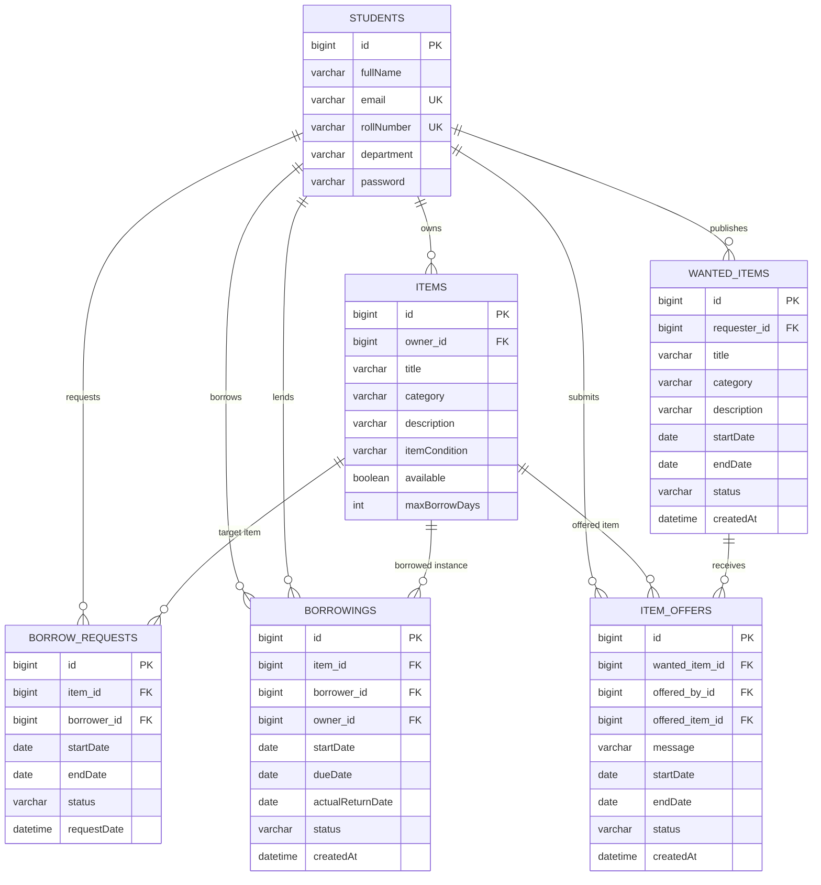

# LendLoop — Campus Peer-to-Peer Resource Sharing Platform

[](https://spring.io/projects/spring-boot)
[](https://www.oracle.com/java/)
[](https://www.mysql.com/)
[](https://www.thymeleaf.org/)
[](#)

> **LendLoop** is a full-stack student-to-student resource lending platform engineered with Spring Boot, Spring Data JPA, MySQL, and Thymeleaf. It empowers university students to share, borrow, and exchange academic textbooks, scientific calculators, laboratory tools, and electronics within a campus community.

---

## 📌 Table of Contents

- [Problem Statement](#-problem-statement)
- [Proposed Solution](#-proposed-solution)
- [Key Features](#-key-features)
- [Technology Stack](#-technology-stack)
- [System Architecture](#-system-architecture)
- [Database Schema & Entity Relationships](#-database-schema--entity-relationships)
- [Project Directory Structure](#-project-directory-structure)
- [Prerequisites](#-prerequisites)
- [Database Setup](#-database-setup)
- [Configuration Guide](#-configuration-guide)
- [How to Run (Windows & Maven Wrapper)](#-how-to-run-windows--maven-wrapper)
- [Accessing the Application](#-accessing-the-application)
- [User Interface & Screenshots](#-user-interface--screenshots)
- [Testing & Quality Assurance](#-testing--quality-assurance)
- [Future Enhancements](#-future-enhancements)
- [Author & Acknowledgments](#-author--acknowledgments)

---

## 🚨 Problem Statement

Every academic semester, college students face significant financial hurdles purchasing high-cost textbooks, single-semester graphing calculators, specialized lab kits, and electronics. Concurrently, senior and peer students have these exact items sitting idle after completing those respective courses. 

Existing commercial secondhand marketplaces fall short in a campus environment because they:
1. Focus primarily on permanent resale rather than short-term borrowing.
2. Involve shipping costs, delays, and friction with strangers.
3. Lack student context (department, roll number, academic peer trust).
4. Do not offer a reverse-demand board where students can request needed gear and receive offers directly from classmates.

---

## 💡 Proposed Solution

**LendLoop** addresses these challenges by establishing a localized, circular peer sharing system within the university:
- **Zero Cost Sharing:** Facilitates peer lending of textbooks, calculators, and lab tools for specific course durations.
- **Student Profile Context:** Student accounts capture roll numbers, departmental affiliations, and student emails with database uniqueness constraints.
- **Bi-Directional Workflows:** Supports both **direct item catalog borrowing** and a **"Wanted Items – Make an Offer" reverse marketplace**.
- **Double-Booking Prevention:** Application-level date-overlap checks and database row-level locking help prevent overlapping borrowings.
- **Two-Step Custody Handover:** A return lifecycle requiring borrower return requests and owner confirmations before items return to circulation.

---

## ✨ Key Features

### 1. Student Authentication & Profile Management
- Student registration capturing Full Name, Department, Roll Number, Email, and Password.
- Unique database constraints on Email and Roll Number to prevent duplicate accounts.
- Password hashing with **BCrypt** via Spring Security's `PasswordEncoder`.
- Session-based state management (`HttpSession`) tracking `studentId` and `studentName` across requests.
- Dedicated Student Profile page displaying account information.

### 2. Item Catalog & Resource Management
- **Add Items:** Owners publish resources with category tags (Textbooks, Electronics, Lab Equipment, Calculators, etc.), descriptions, item conditions, and maximum borrow day caps.
- **Browse & Search Catalog:** Search by keyword and category filtering.
- **My Listings:** Dedicated dashboard for lenders to monitor all items they have contributed.

### 3. Borrow Request & Approval Lifecycle
- Borrowers request an item for specific start and end dates.
- Lenders review incoming requests on the **Received Requests** dashboard with one-click **Approve** and **Reject** controls.
- Date-overlap queries check against active borrowings before approving requests.

### 4. "Wanted Items — Make an Offer" Reverse Marketplace
- **Post a Wanted Request:** Students who cannot find an item can post a request with required dates and descriptions.
- **Wanted Board:** Classmates browse open requests and click **"I Can Lend This"**.
- **Mandatory Owned Item Selection:** Lenders select an available matching item directly from their existing listings.
- **Offer Management:** Requesters review incoming offers and accept or reject them; lenders can withdraw pending offers.
- **Borrowing Bridge:** Accepting an offer creates a genuine `BorrowRequest` and processes it through the approval pipeline, creating an active borrowing record.

### 5. Return Lifecycle & Custody Handover
- **Request Return:** Borrowers initiate a return from **My Borrowings** when ready to hand back the item (status transitions to `RETURN_REQUESTED`).
- **Confirm Return:** The item owner clicks **"Confirm Return"** on **My Lending**, recording the actual return date and marking the item available for future bookings.
- **History Preservation:** Completed borrowings remain preserved in borrowing and lending history views.

### 6. Concurrency & Integrity Checks
- **Pessimistic Database Locking:** Uses `LockModeType.PESSIMISTIC_WRITE` (`SELECT ... FOR UPDATE`) on `WantedItem` and `Item` rows during approval and acceptance transitions.
- **Self-Offer Prevention:** Backend authorization checks preventing users from making offers on their own requests or borrowing their own items.
- **Active Offer Guards:** Prevents multiple active offers from the same student on a single request.

---

## 🛠 Technology Stack

| Layer | Technology | Version / Specification | Description |
| :--- | :--- | :--- | :--- |
| **Backend Framework** | Spring Boot | 4.1.2 | Core application framework |
| **Language** | Java | 21 (LTS) | Runtime environment |
| **Persistence & ORM** | Spring Data JPA / Hibernate | Integrated with Spring Boot 4.1.2 | Object-Relational Mapping with JPQL and Pessimistic Locking |
| **Database** | MySQL | 8.0+ | Relational database storage |
| **Security** | Spring Security | 7.1.2 | BCrypt password hashing & route configuration |
| **Template Engine** | Thymeleaf | 3.x | Server-side HTML template rendering |
| **Frontend Styling** | Custom CSS3 (`inner.css`) | Responsive CSS Grid/Flexbox | Cohesive campus theme, alert banners, and badges |
| **Build Tool** | Apache Maven Wrapper (`mvnw`) | 3.10.0 wrapper | Dependency management and build lifecycle |

---

## 🏛 System Architecture

LendLoop follows the **Model-View-Controller (MVC)** architectural pattern:

```mermaid
flowchart TD
    subgraph Client Layer
        Browser[Web Browser / Mobile Client]
    end

    subgraph Presentation Layer (Controllers & Views)
        Thymeleaf[Thymeleaf Templates: 16 Views]
        SC[StudentController]
        IC[ItemController]
        BRC[BorrowRequestController]
        BC[BorrowingController]
        WIC[WantedItemController]
        IOC[ItemOfferController]
    end

    subgraph Service Layer (Business Logic & Transactions)
        SS[StudentService]
        IS[ItemService]
        BRS[BorrowRequestService]
        BS[BorrowingService]
        WIS[WantedItemService]
        IOS[ItemOfferService]
    end

    subgraph Data Access Layer (Repositories)
        SR[StudentRepository]
        IR[ItemRepository]
        BRR[BorrowRequestRepository]
        BR[BorrowingRepository]
        WIR[WantedItemRepository]
        IOR[ItemOfferRepository]
    end

    subgraph Storage Layer
        MySQL[(MySQL 8.0 Database)]
    end

    Browser <-->|HTTP GET / POST| Thymeleaf
    Thymeleaf <--> SC & IC & BRC & BC & WIC & IOC
    SC & IC & BRC & BC & WIC & IOC --> SS & IS & BRS & BS & WIS & IOS
    SS & IS & BRS & BS & WIS & IOS --> SR & IR & BRR & BR & WIR & IOR
    SR & IR & BRR & BR & WIR & IOR <-->|Spring Data JPA / SQL| MySQL
```

---

## 🗄 Database Schema & Entity Relationships



### Entity State Machines

- **`BorrowRequest` Status:** `PENDING` $\rightarrow$ `APPROVED` | `REJECTED`
- **`Borrowing` Status:** `ACTIVE` $\rightarrow$ `RETURN_REQUESTED` $\rightarrow$ `RETURNED`
- **`WantedItem` Status:** `OPEN` $\rightarrow$ `FULFILLED` | `CANCELLED`
- **`ItemOffer` Status:** `PENDING` $\rightarrow$ `ACCEPTED` | `REJECTED` | `WITHDRAWN` | `CANCELLED`

---

## 📁 Project Directory Structure

```text
Lend-Loop-main/
├── .mvn/wrapper/                  # Maven Wrapper binary & configurations
│   ├── maven-wrapper.properties
│   └── maven-wrapper.jar
├── src/
│   ├── main/
│   │   ├── java/com/lendloop/
│   │   │   ├── config/
│   │   │   │   └── SecurityConfig.java         # Security & BCrypt encoder configuration
│   │   │   ├── controller/
│   │   │   │   ├── BorrowingController.java     # My Borrowings, Lending & Return lifecycle
│   │   │   │   ├── BorrowRequestController.java # Request submission & owner approval
│   │   │   │   ├── ItemController.java          # Catalog browsing & item addition
│   │   │   │   ├── ItemOfferController.java     # Make, withdraw, accept & reject offers
│   │   │   │   ├── StudentController.java       # Registration, login & profile
│   │   │   │   └── WantedItemController.java    # Wanted board & request posting
│   │   │   ├── model/
│   │   │   │   ├── Borrowing.java               # Active & historical borrowing entity
│   │   │   │   ├── BorrowRequest.java           # Booking request entity
│   │   │   │   ├── Item.java                    # Listed resource entity
│   │   │   │   ├── ItemOffer.java               # Reverse lending offer entity
│   │   │   │   ├── Student.java                 # Student user entity
│   │   │   │   └── WantedItem.java              # Wanted item request entity
│   │   │   ├── repository/
│   │   │   │   ├── BorrowingRepository.java     # Overlap queries & borrowing records
│   │   │   │   ├── BorrowRequestRepository.java # Booking request queries
│   │   │   │   ├── ItemOfferRepository.java     # Offer queries & duplicate checks
│   │   │   │   ├── ItemRepository.java          # Catalog queries & Pessimistic Item locking
│   │   │   │   ├── StudentRepository.java       # Student queries by email / roll number
│   │   │   │   └── WantedItemRepository.java    # Wanted item queries & Pessimistic locking
│   │   │   ├── service/
│   │   │   │   ├── BorrowingService.java        # Availability & return logic
│   │   │   │   ├── BorrowRequestService.java    # Overlap validation & approval transaction
│   │   │   │   ├── ItemOfferService.java        # Atomic acceptance bridge & offer workflow
│   │   │   │   ├── ItemService.java             # Item catalog operations
│   │   │   │   ├── StudentService.java          # Authentication & validation logic
│   │   │   │   └── WantedItemService.java       # Wanted board management
│   │   │   └── LendloopApplication.java         # Spring Boot entry point
│   │   └── resources/
│   │       ├── static/
│   │       │   └── css/
│   │       │       └── inner.css                # Shared design system, alerts & badges
│   │       ├── templates/                       # 16 Thymeleaf view templates
│   │       │   ├── add-item.html
│   │       │   ├── browse-items.html
│   │       │   ├── dashboard.html
│   │       │   ├── login.html
│   │       │   ├── make-offer.html
│   │       │   ├── my-borrow-requests.html
│   │       │   ├── my-borrowings.html
│   │       │   ├── my-lending.html
│   │       │   ├── my-listings.html
│   │       │   ├── my-offers.html
│   │       │   ├── my-wanted-items.html
│   │       │   ├── post-wanted-item.html
│   │       │   ├── profile.html
│   │       │   ├── received-requests.html
│   │       │   ├── register.html
│   │       │   └── wanted-items.html
│   │       └── application-example.properties   # Configuration template for developers
│   └── test/
│       └── java/com/lendloop/
│           └── LendloopApplicationTests.java    # Spring Boot context loads test
├── mvnw.cmd                                     # Windows Maven Wrapper script
├── mvnw                                         # Unix Maven Wrapper script
├── pom.xml                                      # Maven POM descriptor
└── README.md                                    # Project documentation
```

> **Note:** Configuration files containing local database credentials (such as local `application.properties`) should not be committed to version control. The repository includes `application-example.properties` as a clean setup template.

---

## ⚙️ Prerequisites

Before launching LendLoop, ensure your local development workstation has the following installed:

1. **Java Development Kit (JDK):** Version 21 LTS.
   - Verify in PowerShell: `java -version`
2. **MySQL Database Server:** Version 8.0 or newer.
   - Verify in PowerShell: `mysql --version`
3. **Command Line Shell:** Windows PowerShell or Command Prompt.

---

## 🗄 Database Setup

1. Open MySQL Command Line Client or your preferred database manager (MySQL Workbench, DBeaver):
   ```sql
   mysql -u root -p
   ```

2. Execute the following SQL statements to initialize the database and a dedicated application user:
   ```sql
   -- Create the database
   CREATE DATABASE IF NOT EXISTS lendloop CHARACTER SET utf8mb4 COLLATE utf8mb4_unicode_ci;

   -- Create a dedicated application user (choose your own username and secure password)
   CREATE USER IF NOT EXISTS 'YOUR_DB_USER'@'localhost' IDENTIFIED BY 'YOUR_SECURE_PASSWORD';

   -- Grant privileges on the lendloop database
   GRANT ALL PRIVILEGES ON lendloop.* TO 'YOUR_DB_USER'@'localhost';

   -- Apply changes
   FLUSH PRIVILEGES;
   ```

3. Hibernate DDL configuration is set to `spring.jpa.hibernate.ddl-auto=update`. All tables, primary keys, and foreign keys will be created automatically upon the first application start.

---

## 🔒 Configuration Guide

### Configuring Local Credentials Securely

To keep credentials secure, create your local `src/main/resources/application.properties` file based on `application-example.properties`. Do not commit real passwords to version control.

#### Template: `application-example.properties`

```properties
# ===================================================================
# LendLoop Configuration Template (application-example.properties)
# ===================================================================

spring.application.name=lendloop

# Database Configuration with Environment Variable Support
spring.datasource.url=jdbc:mysql://${DB_HOST:localhost}:${DB_PORT:3306}/${DB_NAME:lendloop}?useSSL=false&serverTimezone=UTC&allowPublicKeyRetrieval=true
spring.datasource.username=${DB_USERNAME}
spring.datasource.password=${DB_PASSWORD}

# JPA / Hibernate Configuration
spring.jpa.hibernate.ddl-auto=update
spring.jpa.show-sql=true
spring.jpa.properties.hibernate.dialect=org.hibernate.dialect.MySQLDialect

# Server Port
server.port=8081
```

### Setting Database Credentials on Windows

You can supply credentials using environment variables so that your password is never hardcoded.

#### Option A: In Windows PowerShell (Current Session)
```powershell
$env:DB_USERNAME = "YOUR_DB_USER"
$env:DB_PASSWORD = "YOUR_SECURE_PASSWORD"
```

#### Option B: In Windows Command Prompt (CMD)
```cmd
set DB_USERNAME=YOUR_DB_USER
set DB_PASSWORD=YOUR_SECURE_PASSWORD
```

#### Option C: In Local `application.properties` (Uncommitted)
Alternatively, create `src/main/resources/application.properties` locally and substitute your credentials directly, ensuring `application.properties` remains in `.gitignore`:
```properties
spring.datasource.url=jdbc:mysql://localhost:3306/lendloop
spring.datasource.username=YOUR_DB_USER
spring.datasource.password=YOUR_SECURE_PASSWORD
```

---

## 🚀 How to Run (Windows & Maven Wrapper)

The project includes the Maven Wrapper (`mvnw.cmd`), so a separate Maven installation is not required.

### 1. Set Java Environment (If Needed)
If Java 21 is not set as the default in your PATH, point `JAVA_HOME` to your JDK 21 installation in PowerShell:
```powershell
$env:JAVA_HOME = "C:\Program Files\Java\jdk-21"  # Replace with your JDK 21 path
```

### 2. Compile the Project
In PowerShell from the project root:
```powershell
.\mvnw.cmd clean compile
```

Expected output:
```text
[INFO] ------------------------------------------------------------------------
[INFO] BUILD SUCCESS
[INFO] ------------------------------------------------------------------------
```

### 3. Run the Application
Execute the following command to start Spring Boot with the embedded Apache Tomcat container:
```powershell
.\mvnw.cmd spring-boot:run
```

Once the startup log displays:
```text
Tomcat started on port 8081 (http) with context path '/'
Started LendloopApplication in ... seconds
```
The application is running and accessible locally.

---

## 🌐 Accessing the Application

Open your browser and navigate to:
```text
http://localhost:8081
```

### Initial Walkthrough
1. **Register an Account:** Visit `/register` and enter your name, college roll number, department, email, and password.
2. **Log In:** Navigate to `/login` to access the student dashboard.
3. **List a Resource:** Click **+ Add Item** to share textbooks, lab kits, or calculators with classmates.
4. **Browse Items:** Visit `/items` to explore available peer items and submit borrow requests with date ranges.
5. **Wanted Items Board:** Navigate to `/wanted-items` to post a needed item or click **"🤝 I Can Lend This"** to offer one of your listings.
6. **Track Lending & Returns:** Manage incoming approvals on `/received-requests`, active loans on `/my-borrowings`, and confirm returns on `/my-lending`.

---

## 📸 User Interface & Screenshots

*(The previews below are image placeholders. You can capture screenshots from your local browser and place them in a `screenshots/` directory).*

| Page | Description | Placeholder Preview |
| :--- | :--- | :--- |
| **Split-Screen Login** | Modern split-screen authentication featuring platform branding and secure password verification. | `[Placeholder: Save screenshot as /screenshots/login.png]` |
| **Student Dashboard** | Central platform hub with personalized greeting and quick-action navigation cards. | `[Placeholder: Save screenshot as /screenshots/dashboard.png]` |
| **Browse Items Catalog** | Responsive card grid displaying real-time item availability, categories, and borrow duration caps. | `[Placeholder: Save screenshot as /screenshots/browse-items.png]` |
| **Wanted Items Board** | Reverse marketplace where students publish needed items and classmates submit direct lending offers. | `[Placeholder: Save screenshot as /screenshots/wanted-board.png]` |
| **Make an Offer Modal** | Interactive form requiring lenders to select an owned listing and specify availability dates. | `[Placeholder: Save screenshot as /screenshots/make-offer.png]` |
| **My Borrowings & Returns** | Active borrowing dashboard with real-time due dates and the **"Request Return"** action button. | `[Placeholder: Save screenshot as /screenshots/my-borrowings.png]` |
| **My Lending & Confirmations** | Lending tracker featuring real-time return confirmations that restore items to available status. | `[Placeholder: Save screenshot as /screenshots/my-lending.png]` |

---

## 🧪 Testing & Quality Assurance

LendLoop incorporates architectural constraints and defensive checks to ensure data integrity:

### Automated Testing
The repository contains Spring Boot context verification tests in `src/test/java/com/lendloop/LendloopApplicationTests.java`. You can execute the test suite via the Maven Wrapper:
```powershell
.\mvnw.cmd test
```

### Manual Functional Verification Checklist
The following core workflows have been designed and manually verified during feature development:
1. **Student Registration & Login:** Validates required fields, checks for duplicate email and roll number, and hashes passwords using BCrypt.
2. **Item Catalog & Listings:** Verifies adding items with category tags and borrow duration caps, and viewing owned items in My Listings.
3. **Borrow Request Workflow:** Tests requesting items with date ranges and approving/rejecting requests on the Received Requests page.
4. **Date Overlap Prevention:** Verifies that approving an item overlapping with an existing active loan is prevented with feedback banners.
5. **Return Lifecycle:** Tests the borrower requesting a return (`RETURN_REQUESTED`), the owner confirming receipt (`RETURNED`), and restoring item availability.
6. **Wanted Items & Offers:** Tests posting wanted items, offering owned items, withdrawing offers, rejecting offers, and accepting offers with automatic borrowing creation.
7. **Pessimistic Row Locking:** Employs `PESSIMISTIC_WRITE` on `WantedItem` and `Item` repositories to prevent race conditions during acceptance.

---

## 🔮 Future Enhancements

- [ ] **Email Notifications:** Automated email alerts when a borrow request is approved or an item return is requested.
- [ ] **Student Rating & Feedback:** Peer feedback system to encourage on-time returns and well-maintained resources.
- [ ] **Image Upload Support:** File storage (AWS S3 or local uploads) allowing owners to attach photos of their item's physical condition.
- [ ] **Course Code Tagging:** Linking textbooks and lab materials directly to university course numbers (e.g. `CS-201`, `EE-305`).
- [ ] **Calendar Integration:** Exporting borrowing and due dates directly to Google Calendar or iCal format.

---

## 👨‍💻 Author & Acknowledgments

- **Developed by:** K Sree Praharsha
- **Built with:** Java Spring Boot, MySQL, and Thymeleaf
- **Designed for:** Academic and student portfolio demonstration

---

*LendLoop — Borrow More. Share More. Waste Less.*
